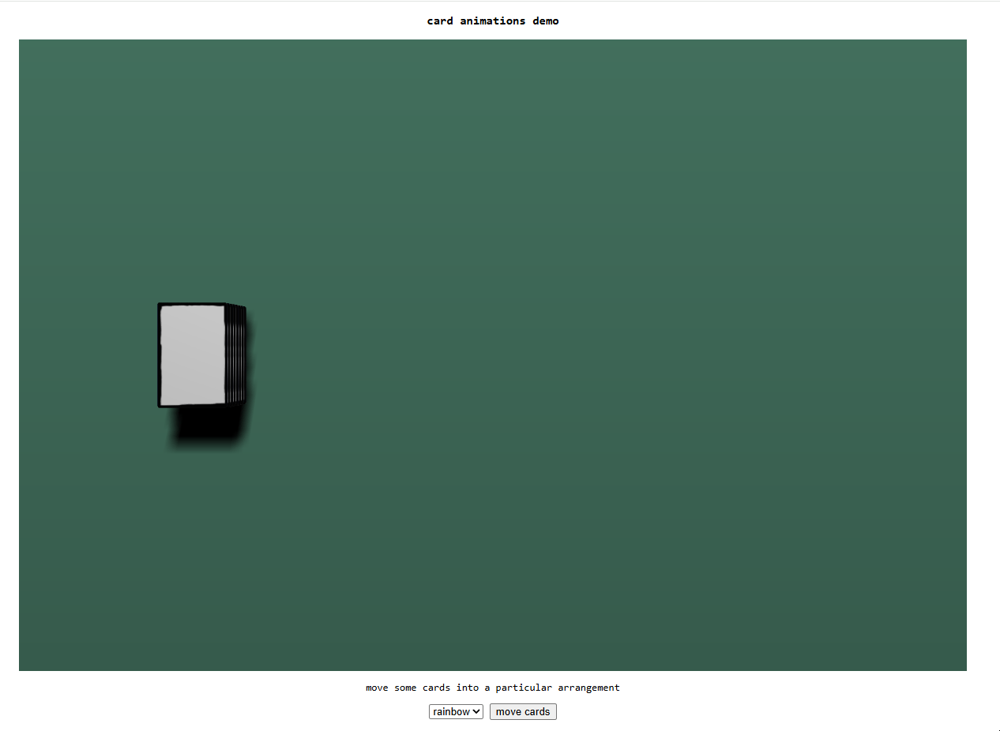
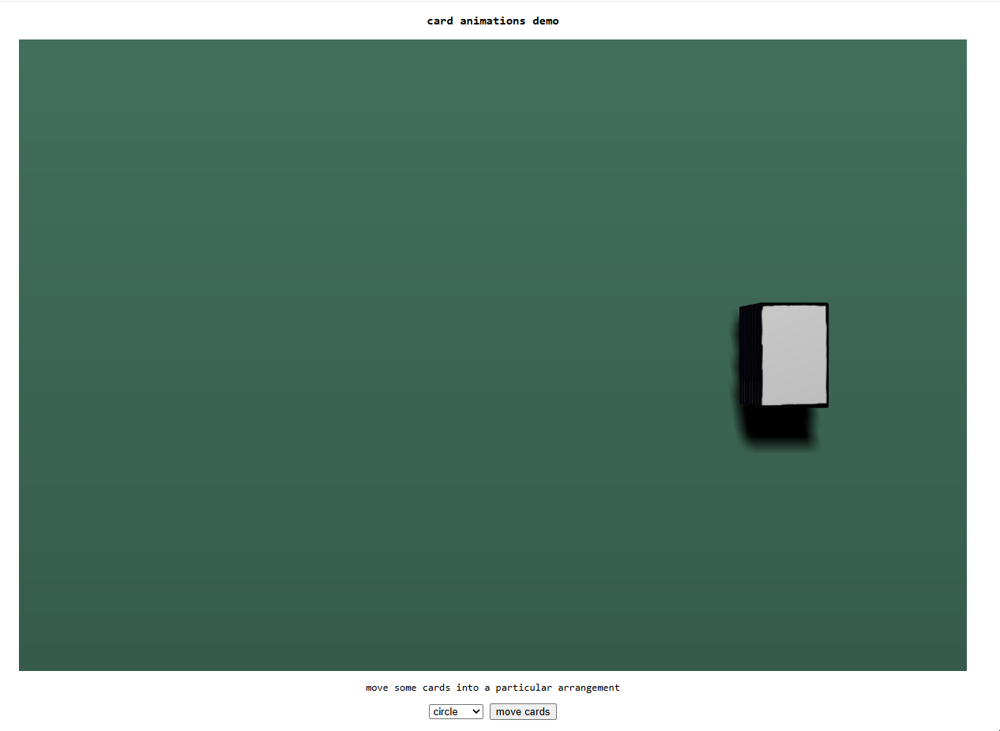
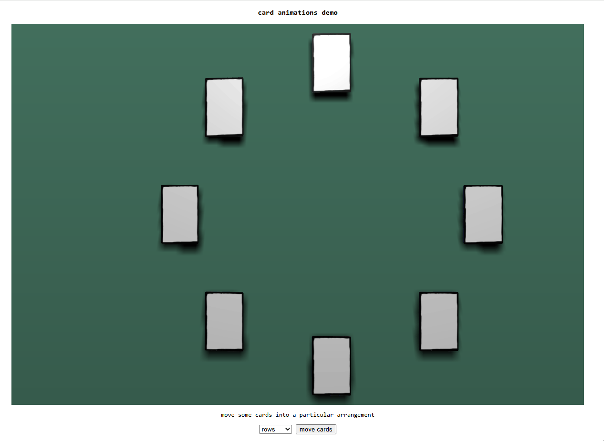
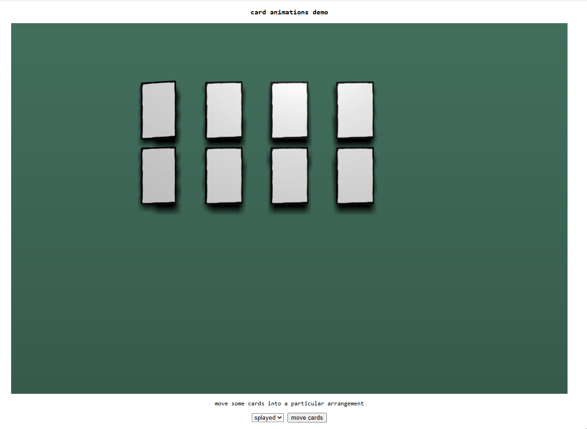

# card_animations
    
implementing some card physics :)    
    
- exporting the card mesh from Blender as gltf **without** `+Y Up` enabled gets the card's coordinate system in the way I'd expect (e.g. as if the card is standing upright)    
  - not sure I quite understand yet what's going on with Blender but just to note 
    
    

    

    

    