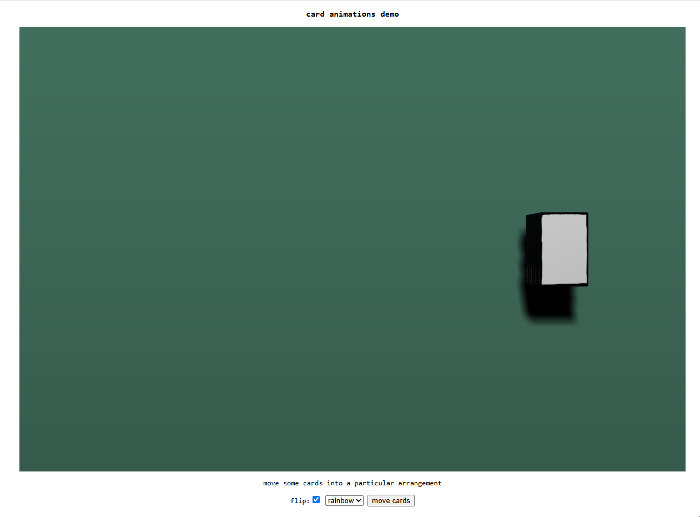
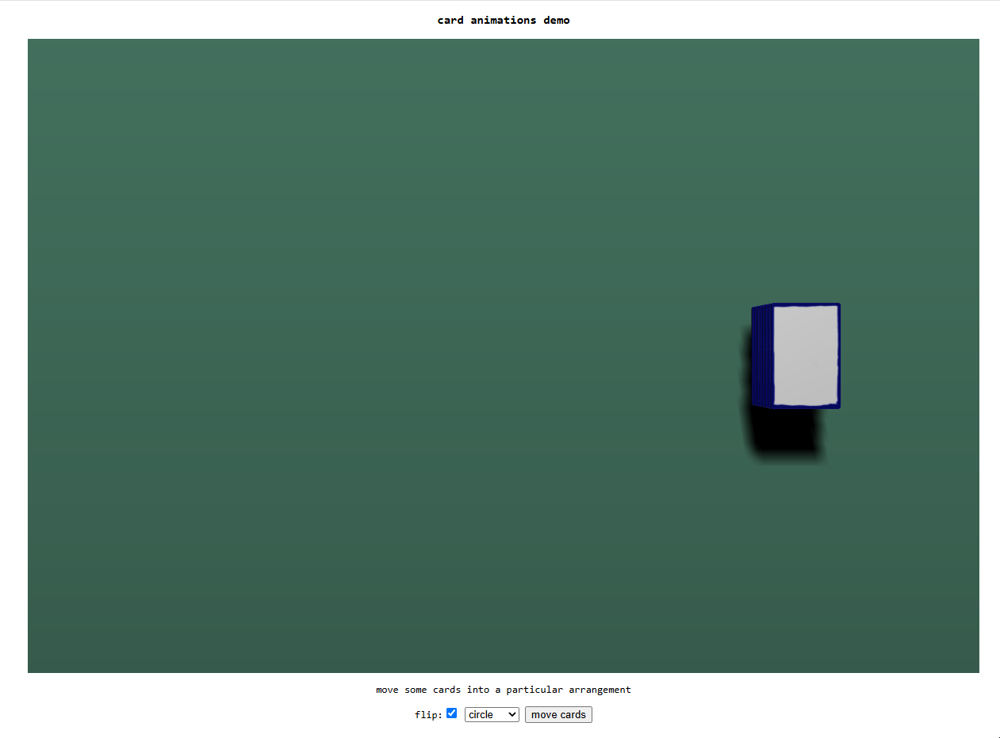
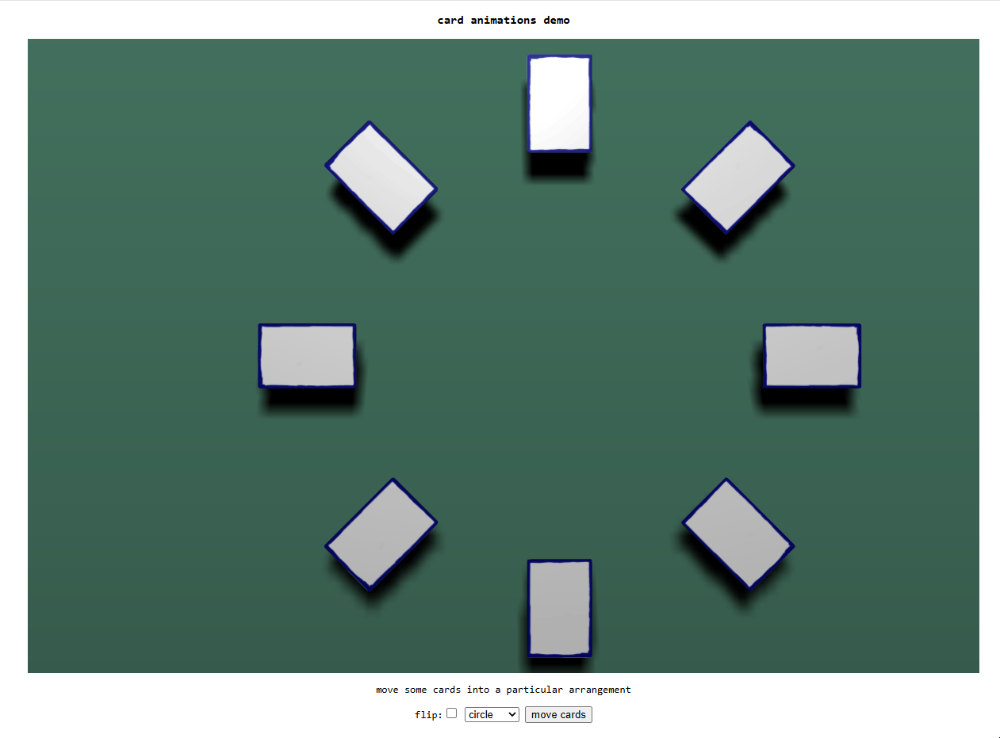
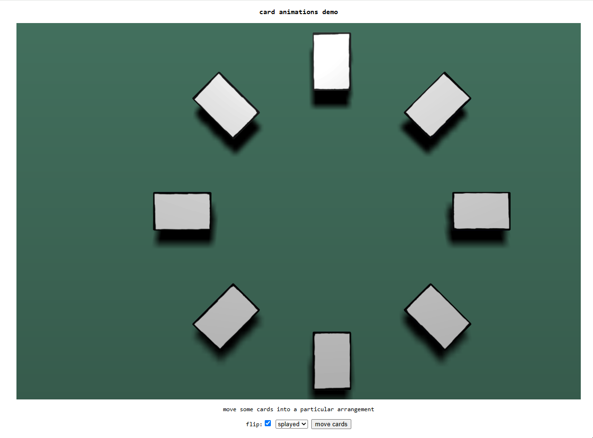
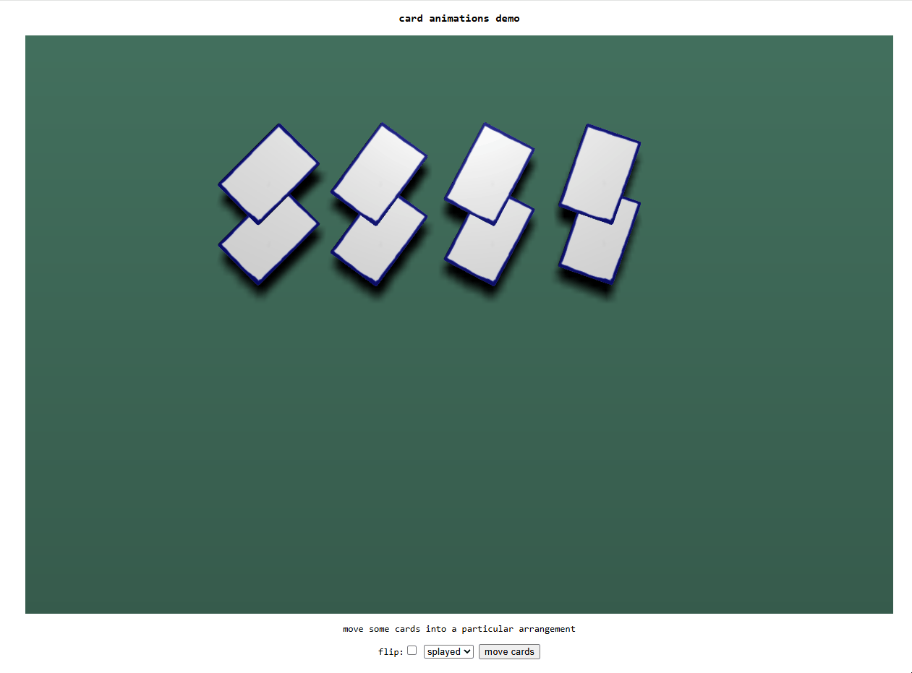

# card_animations
    
implementing some card physics :). based off a previous project I did with Unity: https://github.com/syncopika/card-game-animations    
    
- exporting the card mesh from Blender as gltf **without** `+Y Up` enabled gets the card's coordinate system in the way I'd expect (e.g. as if the card is standing upright)    
  - not sure I quite understand yet what's going on with Blender but just to note 
    
"rainbow" with card flip:    
    
    
"rainbow" without card flip:    
    
    
"circle" with card flip:    
    
    
"circle" without card flip:    
    
    
"splayed" with card flip:    
    
    
"splayed" without card flip:    
    